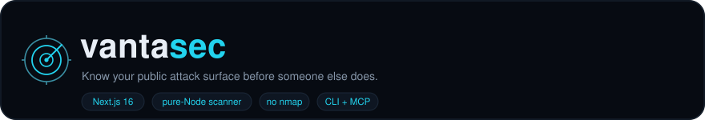
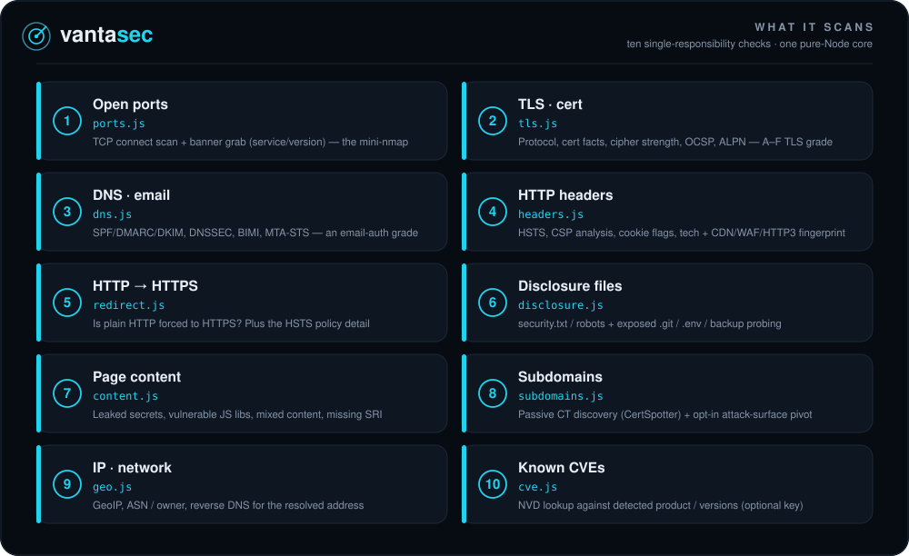
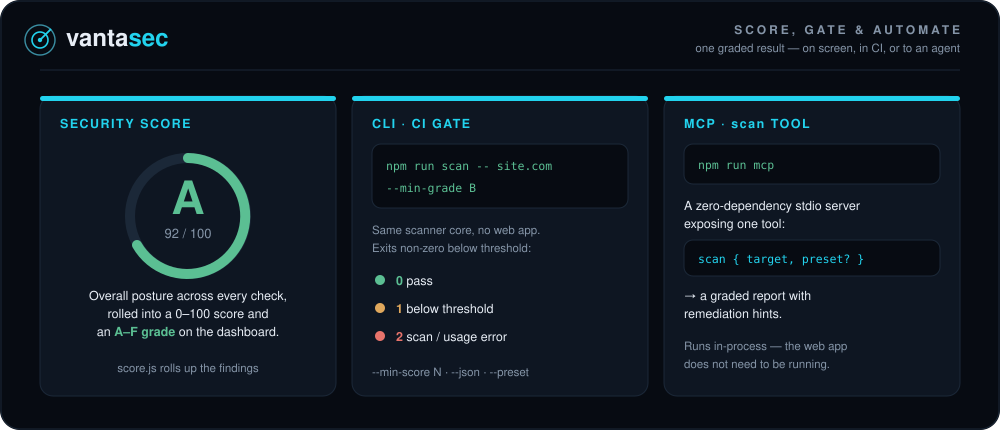
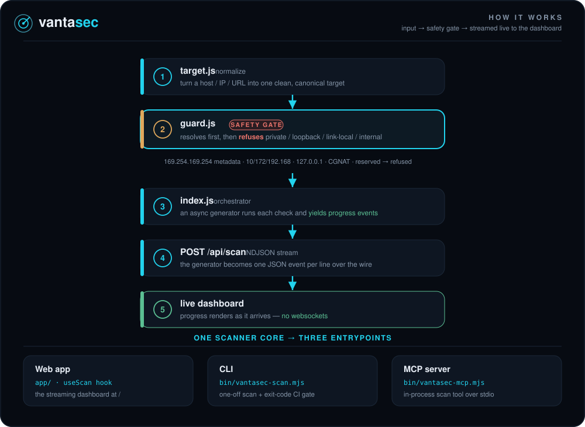

<div align="center">



<br>


**Point it at a server you own and confirm it's actually locked down.**

A self-audit dashboard for your public-facing security posture — open ports, TLS,
DNS & email hardening, HTTP headers, and more. The view an attacker gets, before they do.

</div>

---

## Contents

- [Quick start](#quick-start) · [What it checks](#what-it-checks) · [CVE lookup](#cve-lookup)
- [Command line & CI gate](#command-line--ci-gate) · [MCP server](#mcp-server) · [Score & automate](#score--automate)
- [Architecture](#architecture) · [Safety](#safety--watching-our-own-back) · [Tests](#tests)

## Quick start

```bash
npm install
npm run dev                      # http://localhost:3000
npm test                         # run the unit suite
npm run build                    # production build
npm run scan -- example.com      # one-off scan from the terminal (CI gate)
npm run mcp                      # run as an MCP server (stdio)
```

Scan a website or IP **you own or are authorized to test** for its public-facing
security posture. Built with Next.js 16 (App Router, JavaScript) and a pure-Node
scanner core — **no nmap or other external binaries required**.

## What it checks

<div align="center">
  
</div>

| Check | Module | What it tells you |
|-------|--------|-------------------|
| Open ports | `ports.js` | TCP connect scan + banner grab (service/version) — the "mini-nmap" |
| TLS / cert | `tls.js` | Protocol, cert facts, deprecated-TLS probing, key/cipher strength, OCSP stapling, HTTP/2 (ALPN), and an **A–F TLS grade** |
| DNS / email | `dns.js` | A/AAAA/MX/NS/CAA, SPF/DMARC (+ policy strength), DKIM-selector discovery, BIMI, MTA-STS, TLS-RPT, DNSSEC, and an email-auth grade |
| HTTP headers | `headers.js` | HSTS, CSP (+ weakness analysis), X-Frame-Options, etc. + tech fingerprint, cookie-flag audit, CDN/WAF + HTTP/3 detection |
| HTTP→HTTPS | `redirect.js` | Whether plain HTTP is forced to HTTPS, plus HSTS policy detail |
| Disclosure files | `disclosure.js` | security.txt / robots.txt presence + **exposed sensitive-file** probing (.git, .env, backups…) |
| Page content | `content.js` | Leaked secrets, vulnerable JS libraries, mixed content, scripts missing SRI |
| Subdomains | `subdomains.js` | Passive discovery via Certificate Transparency (CertSpotter); opt-in **attack-surface** pivot scans them all |
| IP / network | `geo.js` | GeoIP, ASN/owner, reverse DNS |
| Known CVEs | `cve.js` | NVD lookup against detected product/versions (optional `NVD_API_KEY`) |

Port presets: **top** (fast, ~17 ports), **common** (curated set), or **custom range** (capped at 2048 ports).

The dashboard also shows an overall **security score (0-100 + A–F grade)**, supports **cancelling** an in-flight scan, **exporting** results (JSON / copyable summary), and keeps a **recent-scans history** in localStorage.

### CVE lookup

CVE checks query the official **NVD API** and work without a key (~5 requests/30s). For higher limits, set `NVD_API_KEY` in the environment before starting the server. Lookups degrade gracefully if rate-limited.

## Command line & CI gate

Run a scan without the web app — the CLI reuses the same scanner core:

```bash
npm run scan -- <target> [--preset common|top|range] [--min-score N] [--min-grade A-F] [--json]
```

It prints a graded summary (or full JSON with `--json`) and **exits non-zero** when the result is below a threshold, so you can gate a pipeline:

```bash
# Fail the build if the production site drops below a B
npm run scan -- example.com --min-grade B
```

Exit codes: `0` pass · `1` below threshold · `2` scan/usage error.

## MCP server

Vantasec also runs as a **Model Context Protocol** server (stdio, zero-dependency) so an AI client can scan on demand — **the web app does not need to be running**; the scanner executes in-process.

```bash
npm run mcp
```

Register it in an MCP client with command `npm`, args `["run","mcp"]`, and the repo as the working directory. It exposes one tool, `scan`, taking `{ target, preset? }` and returning a graded report with remediation hints.

## Score & automate

The same graded result, three ways — on screen, as a CI exit code, or handed to an AI agent:

<div align="center">
   --min-grade B with exit codes 0 pass / 1 below threshold / 2 error); and an MCP scan tool taking { target, preset? } that returns a graded report with remediation hints." width="900">
</div>

## Architecture

Each checker is a single-responsibility module under `src/lib/scanner/`:

- `target.js` — normalize user input (host/IP/URL) into a clean target
- `guard.js` — **safety gate**: refuses private/loopback/internal targets (see Safety)
- `ports.js` — TCP connect scanner with bounded concurrency + banner grabbing
- `tls.js`, `dns.js`, `headers.js` — the individual checks
- `services.js` — port→service map, presets, banner fingerprinting
- `index.js` — orchestrator; runs checks and **yields progress events** as an async generator

The API route `POST /api/scan` adapts that generator to a streaming **NDJSON** response (one JSON event per line), so the browser renders progress live without websockets. The `useScan` hook parses the stream; the page composes form + progress + result cards.

<div align="center">
  
</div>

## Safety — watching our own back

This tool only *reads* what a target volunteers; it never executes or evaluates any response data. Specific protections:

<div align="center">
  
</div>

1. **No remote code execution.** Banners, headers, and certs are treated as inert strings. The UI renders them as text (React auto-escapes — no `dangerouslySetInnerHTML`), so a hostile banner can't inject script into the dashboard.
2. **SSRF / pivot protection.** `guard.js` resolves the target first and **refuses** any host that maps to a private, loopback, link-local (incl. `169.254.169.254` cloud metadata), CGNAT, or reserved range — so the scanner can't be aimed at your own internal network.
3. **Resource limits.** Per-port timeouts, bounded socket concurrency, a banner-size cap (256 chars), and a hard `MAX_PORTS` cap on range scans. Header/redirect/disclosure checks read response **status + headers only — never the target's body**; the only bodies parsed come from trusted APIs (NVD, CertSpotter) and are read under a hard size cap. Discovered subdomains and exposed-file paths are validated to inert hostnames/paths before display.
4. **Abuse protection.** The `POST /api/scan` API is **rate-limited per IP** (in-memory). The app itself ships a strict **nonce-based Content-Security-Policy** (no `unsafe-inline`) plus HSTS and the standard hardening headers.

> Only scan systems you own or have explicit authorization to test.

## Tests

Unit tests (Vitest) cover the pure logic — especially the security guard:

```bash
npm test
```

## License

[MIT](LICENSE) © 2026 Ethan Hoff
